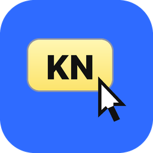
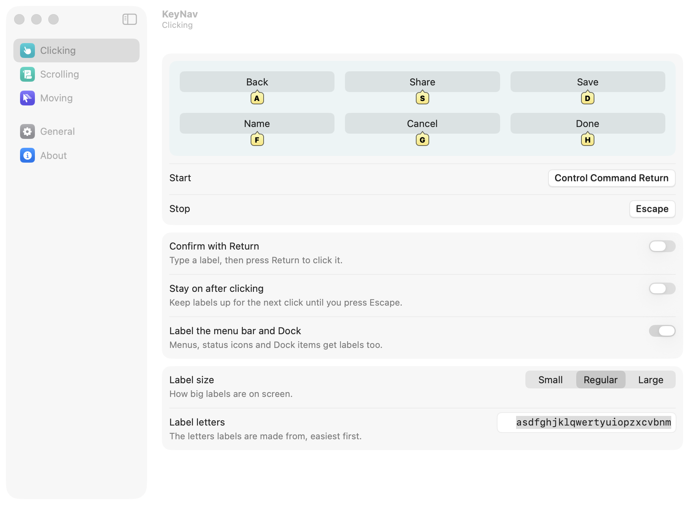

<p align="center"></p>

<h1 align="center">KeyNav</h1>

<p align="center">Use your Mac without the mouse. <a href="https://keynav.app">keynav.app</a></p>

<p align="center"></p>

| Mode | Start | What it does |
|---|---|---|
| **Clicking** | Command Shift Space | Puts a short label on every button, link, and field. Type the label to click it. `/` searches by name. |
| **Scrolling** | Command Shift J | H J K L scroll whatever is in front. Shift jumps most of a window. Tab, or a scroll area's number, moves to another area. |
| **Moving** | Tap Right Option | I J K L move the pointer, Space clicks (hold to drag), Shift Space right-clicks, arrows scroll. |

Escape stops any mode. When all are off, every key types normally.

## Install

Download KeyNav from [keynav.app](https://keynav.app). Every feature is free for 14 days; then a $39 license keeps it working with every future update.

## Build from source

Xcode 16+ (Swift 6):

```bash
scripts/build_app.sh && scripts/install.sh
```

A build you make yourself is free to use on your own Macs; it just doesn't update itself. Pull requests are welcome; see [CONTRIBUTING.md](CONTRIBUTING.md).

## License

Source-available: build it and use it yourself for free, but don't share or sell builds. See [LICENSE](LICENSE).
